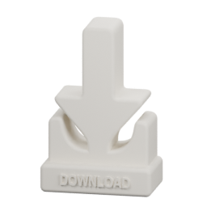
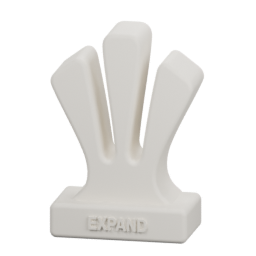
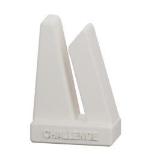
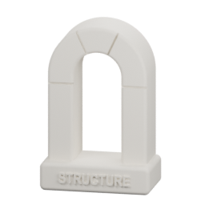
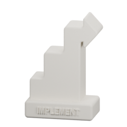

# Modes: choose the kind of help

A mode names the activity shared by the human and AI. It does not set creative
reach, speed or initiative. Those controls remain independent. The supplied
objects are visual cues for choosing an activity; their PNG artwork is included
below. These are artwork images, not photographs or printable 3D models.

The web app works with on-screen mode buttons. With an assigned NFC mode object,
placement selects its mode and lifting the last active mode object clears it.
Choose an on-screen activity to resume without hardware. Switching modes preserves
conversation and steering settings. A perspective visit temporarily changes the
approach; leaving it returns to the current activity.

| Object artwork | Mode | What it asks the model to do | Example request |
| --- | --- | --- | --- |
|  | **Download** | Only learn and clearly articulate what is on the user’s mind, with the lightest structure. Do not add your own ideas, disagree, challenge, or substitute your views. Ask at most one specific clarification when needed. | Help me say what I mean before adding ideas. |
|  | **Expand** | Broaden the idea, explore possibilities and implications, and introduce useful new directions. | What other possibilities does this open? |
|  | **Challenge** | Find weaknesses, ambiguities, internal contradictions and questionable hypotheses. Distinguish factual uncertainty from established error. | Where does my argument fail? |
|  | **Structure** | Work on order, necessary elements and narrative architecture. Help decide what belongs where and why. | What belongs in this piece, and in what order? |
|  | **Implement** | Produce the requested work: write usable text, code, outlines or slide content directly in this conversation. | Write a first draft from this outline. |

## How to use them

Begin with Download when you want help articulating your own thought. Expand
invites additional possibilities; Challenge tests them; Structure organizes;
Implement produces something you can use. This is a vocabulary, not a required
workflow. You can start anywhere and move back and forth.

At initiative levels 1–4, the model is instructed to stay in the activity. Levels
5–6 permit it to choose another activity when useful. These are instructions to
a generative model, not guarantees. Implement produces material in the
conversation; it cannot execute code, browse or edit files in this build.

The ESP32-C6 mode display uses these five supplied PNGs in navy (#292163) on white.
The encoder retains their shading and creates the LVGL image arrays during a
build. The originals shown here remain unchanged. No-mode state has a dedicated
empty-card symbol. The mode screen stays on the activity while the separate
perspective screen shows a visitor.

Edit definitions in [joyride-config.js](../public/joyride-config.js).
The screen firmware has its own artwork/name table; update it when adding modes.
See [customization](CUSTOMIZING.md), [objects and hardware](OBJECTS.md), and
[current status](STATUS.md).
