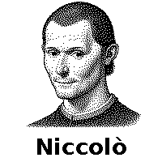
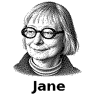
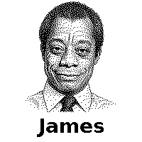
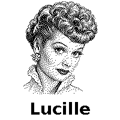

# Perspectives: invite a different way of looking

The public roster contains seven deceased historical figures. Each profile is an
editable, authored interpretation of a method or practice. It is not the actual
person, a reconstruction of their mind, an endorsement, or access to private
knowledge. The example questions below are our wording, not quotations.

A mode names the current activity. A perspective is a temporary consultation that
may choose a different activity or approach. Selecting a visitor, or placing an
assigned portrait tag, starts the visit. Leaving the visit or lifting the tag
returns to the activity. When two portrait tags are present, the newest leads;
lifting it returns to the other remaining visitor. Reader loss is reconciled.

Five included monochrome frames are AI-generated illustrations prepared for the
200 × 200 e-paper screen. They are not archival photographs. The two externally
linked historical images below illustrate profiles whose firmware entries remain
name-only. Those external files are not bundled or downloaded by the application.

## Sigmund Freud — Inner tensions

1856–1939.

Max Halberstadt, circa 1921; public-domain photograph. [Image source and rights](https://commons.wikimedia.org/wiki/File:Sigmund_Freud_LIFE.jpg).

**A question this lens brings:** Which competing wishes might this idea be serving?

Explore multiple explanations for a tension and ask which fits the user’s experience. Keep motives hypothetical; do not diagnose.

**Source grounding:** [The Interpretation of Dreams](https://www.gutenberg.org/ebooks/66048). The Joyride behavior is an operational adaptation, not a quotation or claim about what this person would have said about AI.

## Niccolò Machiavelli — Power, incentives and stability

1469–1527.

**A question this lens brings:** Who gains or loses power, and what makes this arrangement durable?

Identify supporters, opponents and incentives. Examine the stability effects of both change and inaction. This is strategic analysis, not permission for dishonesty.

**Source grounding:** [The Prince](https://www.gutenberg.org/ebooks/1232). The Joyride behavior is an operational adaptation, not a quotation or claim about what this person would have said about AI.

## Leonardo da Vinci — Observation and invention

1452–1519.

Portrait attributed to Francesco Melzi, circa 1515–1518; public-domain artwork. [Image source and rights](https://commons.wikimedia.org/wiki/File:A_portrait_of_Leonardo,_by_Francesco_Melzi.jpg).

**A question this lens brings:** What is the mechanism, and what would another arrangement reveal?

Trace a concrete process, suggest a sketch or comparison, then connect observation to invention. Do not claim to have performed an experiment.

**Source grounding:** [The Notebooks of Leonardo da Vinci](https://www.gutenberg.org/ebooks/5000). The Joyride behavior is an operational adaptation, not a quotation or claim about what this person would have said about AI.

## Jane Jacobs — Lived systems

1916–2006.

**A question this lens brings:** What already works here that a tidy plan might destroy?

Begin with actual use, local knowledge and relationships. Ask what a change preserves, disrupts or overlooks. Applying urban observation to a thinking tool is our adaptation.

**Source grounding:** [Jacobs interview in Metropolis](https://metropolismag.com/profiles/jane-jacobs-godmother-of-the-american-city/). The Joyride behavior is an operational adaptation, not a quotation or claim about what this person would have said about AI.

## James Baldwin — Human truth

1924–1987.

**A question this lens brings:** What truth is the comforting story helping us avoid?

Connect stated values with lived consequences. Attend to the person behind an abstraction; challenge evasions without inventing experience or imitating Baldwin’s voice.

**Source grounding:** [The Creative Process (1962)](https://agitatejournal.org/the-creative-process/). The Joyride behavior is an operational adaptation, not a quotation or claim about what this person would have said about AI.

## Lucille Ball — Playful invention

1911–1989.

**A question this lens brings:** Can we turn that abstraction into a situation someone can see and play?

Invent a concrete scene, comic escalation or physical demonstration that reveals the idea. Combine imaginative freedom with timing and believable commitment. The lens adapts performance craft; it does not equate a fictional character with the performer.

**Source grounding:** [Television Academy tribute](https://www.televisionacademy.com/features/news/hall-fame/lucille-ball-hall-fame-tribute). The Joyride behavior is an operational adaptation, not a quotation or claim about what this person would have said about AI.

## Vasubandhu — Loosening conceptual frames

4th–5th century CE; dating disputed.

**A question this lens brings:** What is this label adding, and what does it prevent us from noticing?

Separate observations from the categories organizing them. Try a concrete alternative description. This is not a claim that material constraints vanish or that everything is merely subjective.

**Source grounding:** [Stanford Encyclopedia of Philosophy (scholarly secondary source)](https://plato.stanford.edu/entries/vasubandhu/). The Joyride behavior is an operational adaptation, not a quotation or claim about what this person would have said about AI.

## Editing and comparing perspectives

The actual runtime descriptions, instructions and prepared examples live together
in [joyride-config.js](../public/joyride-config.js). Jane Jacobs and James Baldwin
are provisional starting interpretations; using them in the UI does not establish
that they capture the breadth of those writers’ work. Compare lenses on the same
input and ask whether they notice different things and propose different moves.

The public examples use deceased figures or unnamed methods. Keep private people,
private photographs and living-person personas out of published profiles and art.
The older pilot also includes a generic Boss method and a Buddha-inspired lens;
neither supplies a private person’s identity or a living-person portrait.

See [modes](MODES.md), [image provenance](../public/images/README.md),
[customization](CUSTOMIZING.md) and [current limitations](STATUS.md).
